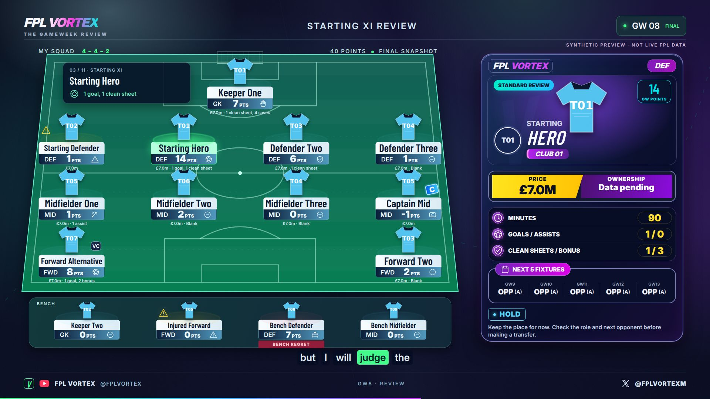

# Day 1 · the review happens on the pitch



`Day1Premium` now uses a continuous animated squad pitch, reference-style pop-up heroes and nine broadcast scenes. The production adapter retains **3840 × 2160, 24 fps, H.264/AAC** and the existing private upload/output contracts. Local sample previews use 1920 × 1080 at the same frame rate. The notebook `1_final_day1.py` is unchanged.

| Time | Scene | Presentation |
| --- | --- | --- |
| 0:00–0:18 | OpeningSequence | Immediate captain/score conflict, stadium light, three floating player files |
| 0:18–0:50 | MatchweekHighlights | Selected verified match results; carousel, no score roll call |
| 0:50–1:40 | TopPerformers | Five-second radar, then three 15-second event spotlights |
| 1:40–2:25 | WorstPerformers | Three 15-second factual decision checks |
| 2:25–2:55 | MyGameweekSummary | Score versus average, best return, regret and captain contribution |
| 2:55–3:25 | AnimatedSquadPitch | Sequential formation entrances, captain/VC, separate bench |
| 3:25–5:50 | PlayerReviewSequence | All eleven starters, 13.18 seconds each; pitch selection and hero |
| 5:50–6:20 | BenchReview | All four substitutes, actual multipliers and availability |
| 6:20–6:40 | ClosingPlan | Three provisional decisions and one specific question |

## Branding and reference assets

Change the exact YouTube channel name/handle and X handle in **`src/brand.ts`**. Defaults preserve the repository identities: **FPL VORTEX / @FPLVORTEX / @FPLVORTEXM**. Set `logo`, `youtubeIcon` and `xIcon` to public-relative paths for local overrides. Production prefers the real `show.brand_logo`, loaded from the existing Drive `elements/logo.png`. Existing repository social icon files were absent, so bundled SVG icons supply the fallback.

The supplied design assets are saved at **`public/reference/player-card.jpg`** and **`public/reference/squad-pitch.jpg`**. Replace those when refining the reference. `PlayerCard` recreates the navy/violet glass shell, cyan role pill, portrait above the crest/italic name, yellow price and purple ownership ribbon, circular stat icons, yellow value pills and magenta fixture header. Card and club tokens live in **`src/brand.ts`**; layout, typography, dimensions and CSS variables live in **`src/premium.css`**. The pitch is original SVG, not a screenshot.

`PlayerCard` supports Top Performer, Warning, Captain, Bench Haul, Injury Doubt, Clean Sheet and Standard Review variants. `AnimatedSquadPitch` accepts formation, XI, bench, captain/vice captain, points, selected/previous player, events and availability. Selection keeps the full formation visible with a restrained camera move. Heroes grow from the corresponding pitch/bench position. Event motion includes goal trails, pass lines, clean-sheet shields, save rings, armband calculations, regret glow and availability markers.

## Local preview

```sh
cd remotion-day1
npm ci
npx remotion browser ensure
npm run dev
```

Select **Day1Premium** in Studio. It opens with **`sample-props.json`**, a clearly labelled synthetic fixture with shirt/crest fallbacks. It is not a real FPL report. Regenerate it from the test data with `python scripts/make-sample.py` from this directory. The Python builder has no third-party dependencies. Keep Studio open while changing components.

To preview an actual run, use the props written by the production adapter, and retain its temporary `public/runtime/<run-id>` assets while Studio is open:

```sh
npm run dev -- --props=/absolute/path/to/remotion-props.json
```

## Local render and checks

```sh
npm run lint
npx remotion versions
npm run build
npx remotion render src/index.ts Day1Premium out/sample.mp4 --props=sample-props.json --codec=h264 --pixel-format=yuv420p
npx remotion still src/index.ts Day1Premium out/review.png --props=sample-props.json --frame=5328
```

The sample has no narration/music and exports a visual test. For a production video, run the established Day 1 workflow; it synthesizes and fits the existing Edge Ryan narration, supplies real media, renders picture and muxes/mixes audio. `node scripts/inspect-media.mjs FILE [MINIMUM_SECONDS]` uses pinned Mediabunny to preflight the actual audio before expensive rendering. Missing/short audio stops the render. All Remotion packages remain aligned at the verified stable version **4.0.539**, with **Mediabunny 1.62.0** matching Studio.

From the repository root:

```sh
python -m unittest discover -s tests -p 'test_day1*.py' -v
```

The tests cover original contracts plus nine-scene pacing, all fifteen reviews, league/squad separation, actual bench/autosub/captain multipliers, absent event stats, narration word limits, conservative availability and local sound cues. Runtime assets, bundled output and rendered videos are ignored by Git.

## Data and narration

`vortex/day1_show.py:prepare_show` still freezes the existing final FPL snapshot and reconciles the total. **`vortex/day1_review.py`** reads league returns, review event statistics and completed fixtures from **that same snapshot**; it never fetches an extra feed. Only six league spotlight identities are resolved in addition to the original squad images. The package remains the source of truth; a separate normalized presentation view adds events, verdicts and analysis.

The 700–950-word script uses the verified picks, score, average, event stats, current availability and next fixtures. No sample player names, scores, price, injury or result is substituted into production. If league data is absent in an archived local fixture, the scope is explicitly labelled *verified squad; league data pending*. Missing optional price, ownership, fixture and event fields display **Data pending** or are omitted. A return date is never inferred. Core finality, points and legal squad validations still fail closed rather than silently inventing an official total.

The legacy seven-section builder/composition remains available for archived input contracts. New production shows use `VORTEX-PITCH-REVIEW-2`. Word boundaries remain fitted through the existing natural tempo gate; captions, selection and section timing share the same clock. Three portrait Shorts retain both pitch and hero and use complete 15–30-second sections.

## GitHub Action

**Actions → Day 1 → Run workflow** triggers **`.github/workflows/day-1.yml`** through the existing `workflow_dispatch`. The existing watcher can still dispatch it. No trigger, data source, credential, visibility or upload setting changes.

The Action runs `npm ci`, lint/typecheck, package-version alignment and browser setup; validates the immutable 33-cell notebook and existing/new evidence tests; restores the existing Drive assets; and executes the patched cells in order. `prepare_show` builds the review, `render_show` synthesizes narration, and `vortex/day1_remotion.py` calls the existing **Day1Premium** composition. The existing FFmpeg flow muxes audio and adds the quiet music bed with speech sidechain ducking. Sparse local whoosh, impact and synthesized stadium-swell cues follow verified events. No external runtime audio downloads are needed. The final MP4, combined MP3, JSON, captions, QA, three Shorts and Private-only YouTube packaging retain their established destinations.

## Persistent footer and original popup

`PremiumFooter` animates once on the global video clock and remains below the pitch, hero and captions. YouTube identity is left, episode label centre, X identity right. The original required `popup.mp4` still restarts at 2:00, 4:00 and 6:00 without extending the show; it occupies the reserved centre of the footer, preserves its aspect ratio and stays muted. The actual file hash and occurrences remain in `DATA/day1_remotion_qa.json` alongside the authoritative show digest, section IDs, frame rate and resolution.
